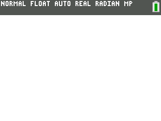
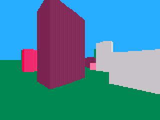

# Voxel Engine CE

A real-time voxel renderer for the **TI-84 Plus CE**: filled, shaded faces with hidden surface
removal, a chunked world streamed from an AppVar, and a first-person player that walks, jumps and
collides with the world. It runs on a 48 MHz eZ80 with no FPU and no hardware divide, so the hot
paths are hand-written eZ80 assembly and everything else is table lookups and additions.

For now it is an engine; once it is in a ready state it will be used to make a couple of games.





## Features

- **Filled voxels with exact hidden surface removal.** Boxes are drawn front to back, and every
  screen row keeps a list of the x intervals nothing has covered yet, so hidden pixels are never
  written and boxes behind a full screen are not looked at.
- **Exact painter's order** without per-frame sorting: voxels are kept sorted by Manhattan distance
  from the camera's cell, which is exact for unit cubes, and a chunk is only re-sorted when the
  camera moves into a cell that changes its order.
- **Chunked worlds** of up to ~16k voxels in an AppVar (archived worlds are read straight from
  flash). The 7 x 7 chunks around the camera are kept in RAM and streamed in as you walk.
- **Render distance 24**, adjustable at runtime (`render_dist`).
- **Level of detail:** distant boxes become single rectangles.
- **Near-plane clipping:** walls stay solid when you stand right against them.
- **Distance fog:** distant boxes and the ground fade into the
  sky colour, so nothing pops in at the far plane.
- **Ground plane** drawn as background for free, so a floor costs nothing.
- **Collision and physics:** the player slides along walls, falls off ledges, jumps onto voxels,
  hits ceilings and crouches under overhangs.
- 160 x 120 logical pixels at 16 colours, using the LCD's 4bpp mode with 2 x 2 pixels.
- Frame rate depends on the view: high teens with big objects up close (the slowest case), up to
  40+ in open views.

## Controls

| Key | Action |
|---|---|
| [up] / [down] | walk forwards / backwards |
| [left] / [right] | turn (releasing near north, east, south or west snaps onto it) |
| [mode] / [del] | strafe left / right |
| [2nd] | jump (hold to keep jumping) |
| [alpha] | crouch |
| [clear] | pause menu: back to the game, settings, save & quit (keeps your position), quit without saving |

## Building

You need the [CE C toolchain](https://ce-programming.github.io/toolchain/) (CEdev v15) with
**ez80-clang v22 or newer**. CEdev bundles an older compiler, so install the
[nightly compiler release](https://github.com/CE-Programming/llvm-project/releases/nightly) and
extract `ez80-clang` and `ez80-link` into `CEdev/bin`. Python 3 is used to generate the world.

```sh
make          # bin/CALCRAFT.8xp, the test world bin/WORLD.8xv and the big worlds (TUTORIAL, ISLANDS, PLAINS .8xv)
make debug    # -O0 with dbg_printf
```

Send `CALCRAFT.8xp`, `WORLD.8xv` and the [CE C libraries](https://github.com/CE-Programming/libraries/releases)
(`clibs.8xg`) to the calculator. On TI-OS 5.8 and later, native programs need a jailbreak such as
[arTIfiCE](https://yvantt.github.io/arTIfiCE/) to run. Besides the program itself, the chunk window
needs about 15 KB of free RAM (a temporary AppVar, deleted on exit).

### Worlds

`utils/make_world.py` builds the world AppVar. Its docstring documents the file format.

```sh
python3 utils/make_world.py bin/WORLD.8xv                    # the test world (default)
python3 utils/make_world.py bin/WORLD.8xv --preset random    # random boxes on a ground plane
python3 utils/make_world.py bin/WORLD.8xv --preset dense     # worst case: every chunk nearly full
python3 utils/make_world.py bin/TUTORIAL.8xv --preset tutorial --appvar TUTORIAL   # big and sparse:
python3 utils/make_world.py bin/ISLANDS.8xv --preset islands --appvar ISLANDS      #   192 x 192 cells,
python3 utils/make_world.py bin/PLAINS.8xv --preset plains --appvar PLAINS         #   a few features in view
```

With no world on the calculator the game starts anyway: it says where to download one, and
Play > New makes an empty one.

A world is split into 8 x 8 cell chunk columns of up to 255 voxels each, with 16 materials (the
palette colours, shaded per face). The file stores which faces of each voxel are exposed, so
loading a chunk is a copy. The engine checks the file's CRC and every value on load, and records
the last played date when you quit.

## Project layout

| Path | Contents |
|---|---|
| `src/main.c` | the main loop |
| `src/display.{h,c}` | LCD setup, double buffering, de-interlacing |
| `src/colours.{h,c}` | palette and material colours |
| `src/player.{h,c}` | input, movement, jumping and crouching |
| `src/collide.{h,c,S}` | collision with the world |
| `src/camera.{h,c,S}` | per-frame camera setup |
| `src/chunks.{h,c}` | the chunk window: loading, painter's sort, face exposure |
| `src/scene.{h,c}` | chunk culling and projection of the visible voxels |
| `src/world.{h,c}` | the world file |
| `src/hud.{h,c}` | HUD (FPS, voxels on screen, frame time; toggled in settings) and the bench's profiling counters |
| `src/project.S` | per-voxel culling and projection |
| `src/fill.S`, `fill.h` | the rasterizer; `fill_ref.c` is the same algorithm in C, for testing |
| `src/sort.S`, `chunk.S`, `deinterlace.S` | sorting, chunk loading and exposure, the row copy |
| `src/engine.h` | constants and layouts shared by C and assembly |
| `src/projection_tables.{h,c}` | generated by `utils/gen_tables.py` |
| `utils/` | world and table generators, CEmu scripts, benchmark and collision tests |

`CLAUDE.md` is the detailed technical description: units, memory layout, the culling proofs,
the rasterizer, and measured costs.

## How a frame works

1. **Player:** keys set target speeds; the player moves and is pushed out of walls, floors and
   ceilings through a small bit grid of the voxels around it.
2. **Camera:** per-frame tables of `(grid line - camera) * cos/sin`, so every voxel corner is two
   lookups and an add.
3. **Chunks:** culled against the view as a whole, visited nearest first, re-sorted only when needed.
4. **Projection** (`project.S`): voxels whose visible faces are all covered by neighbours are
   skipped first, the rest culled in camera space and projected with
   `64 * a / z = exp(log |a| - log z)` from tables, with no multiply or divide.
5. **Rasterization** (`fill.S`), before waiting for the LCD: front to back, each face is clipped
   against the still-open parts of its rows, and only visible spans are listed.
6. **Drawing**, after the LCD has finished showing the previous frame: background in open rows, then
   the spans (unrolled `push` runs for long ones), a row copy for the 2 x 2 pixels, and a swap.

## Testing

All of these run the program in [CEmu](https://ce-programming.github.io/CEmu/) and save screenshots:

```sh
utils/run_cemu.sh                                  # run the build, screenshots in /tmp/cemu_run
utils/bench/run_bench.sh /tmp/b -DBENCH_VIEWS=100  # cycle counts per phase over 100 views
utils/bench/run_bench.sh /tmp/b -DFILL_REFERENCE   # + compare every frame with fill_ref.c
utils/test/run_collide_test.sh /tmp/c              # scripted walks, jumps and crouches
```

They need a ROM image and `clibs.8xg` and `arTIfiCE_v2.1.8xp` (paths at the top of
`utils/run_cemu.sh`).

## VS Code

If IntelliSense complains, edit `.vscode/c_cpp_properties.json` to point at your CEdev: set the
compiler path to `CEdev/bin/ez80-clang` and the include path to `CEdev/include` (replacing
`${default}`, not appending to it).

## TODO

- [x] Merge coplanar faces of big flat objects (walls, steps): side faces in runs of up to 8, one
      orientation per chunk (tops and vertical merging not yet)
- [x] Clip boxes at the near plane instead of stretching them
- [ ] Write runtime world changes back to the file
- [x] Distance fog (on in every build)
- [x] Use a scratch AppVar for more memory (bss is nearly full)
- [x] Add main menu (ideally with a world rendering in the background) with "Play", "Settings", and "Quit"
- [x] Add world menu, and let users select world to load
- [x] Add settings menu with render distance and FPS toggle
- [x] Remove draw time from HUD, add voxel count
- [x] Add pause menu
- [ ] Add license (why wasn't this done three years ago...)
- [ ] Update title edition text

## Changelog

***v1.2.1*** - Memory and performance optimizations

***v1.2.0*** - Merged faces: walls and the sides of steps are drawn as runs of up to 8 faces
(world format 3). About 4-6% faster up close and walking, the same at a distance.

***v1.1.0*** - Render distance 16 -> 24 (7 x 7 chunk window, chunks in bss, spare VRAM and a scratch
AppVar), near-plane clipping (walls no longer vanish when you stand against them), a distance fog
build (`make fog`), and the 2 x 2 pixel level of detail removed.

***v1.0.0*** - Filled voxel rendering with hidden surface removal, chunked worlds in an AppVar,
level of detail, a ground plane, crouching and jumping, collision with the world (walls, floors,
ceilings, jumping onto voxels). Code split into modules; faster chunk culling and camera setup.

***v0.2.7*** - Added DrawBasePlane, multiple bug fixes, small optimizations, and code changes

***v0.2.6*** - Fully implement planes, optimize existing algorithms, updated trapezoid routine, other small changes

***v0.2.5*** - Fix clipping algorithm, improve `powAZx50.py` script, fix render algorithm, add coordinate view, add basic `drawPlane()` function - only able to lay flat.

 - Note: v0.2.4 was skipped...I did a funny and accidentally labelled it as v0.2.5.

***v0.2.3*** - Add fully functioning `sortCoordinateList()` method, optimize filling algorithm, add functionality for drawing only visible parts of an object.

***v0.2.2*** - Code cleanup, remove excess code, optimizations, removed vertex cache, currently the fastest version.

***v0.2.1*** - Added cache for common vertices. May be slower? We'll see, for now the cache is set to 1.

***v0.2.0*** - **Massive** speed boost, over 6x speed

***v0.1.0*** - First demo
